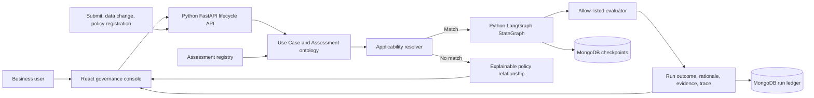

# Ontology AI Governance Control Plane

An executive-ready demonstration of AI Use Case Lifecycle Management for a Chief AI Officer. It shows how an ontology connects business entities, policy definitions, applicability, governed assessment execution, accountable outcomes, and evidence lineage.

## CAIO demonstration narrative

1. **Start with the operating question:** How does the organisation know every AI use case has the right reviews at the right time?
2. **Show the portfolio as governed entities:** Each record carries business purpose, owner, technology, data, decision behaviour, customer impact, and control impact.
3. **Submit an AI use case:** The use-case description policy checks six quality dimensions. Other assessment policies run only when their applicability predicates match the recorded facts.
4. **Inspect the run evidence:** Select a run in Run history to inspect LangGraph node events, timings, redacted checkpoint state summaries, outcome, rationale, evidence, and recommendation. Use **Run again** to produce a fresh, inspectable execution.
5. **Change a business fact:** Editing the use case triggers new applicable runs; prior results remain in the evidence ledger.
6. **Register a new policy:** Add a supported assessment definition and applicability predicate. The runtime scans existing use cases and executes it for matches.
7. **Close on the architecture:** This is an ontology-backed operating loop, not a static inventory: events resolve against business meaning and policies, execute as controlled graph workflows, and persist evidence.

## CAIO presenter runbook

Use the **CAIO demo guide** button in the top bar to keep this five-beat, approximately 4.5-minute narrative beside the live application. Each guide action opens the matching screen.

| Time      | Screen and action                                                                  | Presenter line                                                                                                                                           | Proof point                                                                                    |
| --------- | ---------------------------------------------------------------------------------- | -------------------------------------------------------------------------------------------------------------------------------------------------------- | ---------------------------------------------------------------------------------------------- |
| 0:00–0:45 | **Overview** — point to governed use cases, review signals, and recent events.     | “The executive question is not how many AI use cases we have; it is whether every one is connected to the right controls and accountable decisions.”     | Live portfolio and lifecycle signals.                                                          |
| 0:45–1:45 | **Ontology** — select AI Use Case, then select `evaluated by` or `emits evidence`. | “These are typed business concepts and relationships. A use case belongs to a business unit, is evaluated by a policy, and produces runs with evidence.” | Class properties, predicate direction, source mappings, instance counts, and observed triples. |
| 1:45–2:45 | **Use cases** — open a submitted record and inspect its assessment lineage.        | “A use case is a living governed entity. Submission and material changes resolve its facts against policy scope and launch applicable assessments.”      | Structured use-case dimensions, status, evidence, and immutable previous runs.                 |
| 2:45–3:45 | **Assessments** — explain applicability and the existing-portfolio scan.           | “When a new policy is registered, the same ontology checks existing use cases for scope and executes the matches immediately.”                           | Controlled evaluator, applicability predicate, and linked run count.                           |
| 3:45–4:30 | **Run history** — select a run, expand a checkpoint, then click **Run again**.      | “The graph is inspectable step by step: we can see which node ran, what it concluded, and how the graph state changed at each checkpoint.”               | Persisted node events, per-node timing, five real LangGraph state-history checkpoints, and a new run created from the UI. |

### Suggested closing

“The value is the operating model: one connected representation of business use cases, policy scope, execution, and evidence. As the portfolio changes, the control view updates with it. This demo makes that chain inspectable end to end, while keeping assessment execution inside a controlled runtime.”

### Live demonstration tips

- Use **Customer service copilot** to show a complete description and its assessment evidence; use **Transaction monitoring alert prioritisation** to show financial-crime control applicability.
- For the live lifecycle moment, open **Mortgage document quality review** and click **Submit & assess**. The draft is persisted, so create a fresh draft or reset the isolated demo volume before repeating the exact same walkthrough.
- When demonstrating registration, state that the four built-in evaluators are controlled demo logic; the extension point is the evaluator contract, not arbitrary uploaded code.
- To show portfolio-wide policy expansion, register a **Sanctions Control Review** under **Financial crime** with the **Financial-crime control** evaluator. Its signal-based scope scans existing use cases and runs only for matches.
- In the Ontology inspector, distinguish persisted entities from vocabulary values projected from current records. Evidence Item is embedded in its Assessment Run.

## Start the complete demo

Requirements: Docker Desktop with Compose.

```bash
docker compose up --build
```

Open [http://localhost:8080](http://localhost:8080). The Compose stack uses its own persistent MongoDB volume and binds MongoDB to port `27018`, so it does not conflict with another local MongoDB on port `27017`. The demo portfolio is seeded only when the database has no use cases; existing records are never overwritten. Seed behavior can be disabled with `SEED_DEMO_DATA=false`.

Stop the stack while keeping evidence and demo data:

```bash
docker compose down
```

Delete the demo database volume only when you intentionally want to reset all demo data:

```bash
docker compose down -v
```

## Local development against MongoDB

Requirements: Python 3.12 and Node.js 20 or newer. If a MongoDB instance is available at `mongodb://127.0.0.1:27017` without authentication:

```bash
cp .env.example .env
python3 -m venv .venv
source .venv/bin/activate
python -m pip install -r server/requirements.txt
npm install
npm run dev
```

The Python API listens on port `4000`; Vite listens on port `5173`. Set `MONGODB_URI` to a MongoDB connection string available to the local API process. The Compose stack is the easiest isolated option when the existing MongoDB requires credentials.

Useful commands:

```bash
npm test
npm run build
```

## What runs in the runtime

Assessment execution is implemented with **Python LangGraph `StateGraph`**. Each assessment has an execution ID and follows explicit graph nodes:

```text
resolve_applicability → execute_assessment → prepare_evidence
```

A non-matching policy exits after applicability resolution and is recorded as a skipped execution with its reason. A matching policy runs its allow-listed evaluator and prepares evidence in the graph. The API persists a `running` record before dispatch, then appends structured logs, node updates, and safe checkpoint summaries as execution advances. Submission, data changes, assessment registration, and manual reruns are distinct trigger events in the ledger. Each run receives a LangGraph `thread_id` and a MongoDB-backed `MongoDBSaver` checkpointer. The Run history screen refreshes active runs every second and shows their live status, ordered runtime logs, node timings, and checkpoint history. Historical Node.js-era runs remain readable and are marked as legacy when they have no runtime telemetry.

The demo intentionally uses deterministic, explainable evaluator logic rather than external LLM calls. UC Description Assessment scores coverage of problem, users, data, technology, decisions, and controls. The other evaluators demonstrate model/NMND classification, regulatory review signals, and financial-crime control impact.

### Runtime boundary

LangGraph is the **workflow runtime**, not a sandbox. Assessment definitions cannot upload Python or execute user-supplied code. Registration validates a fixed evaluator kind, fixed field allow-list, and supported operators; evaluator logic executes in the trusted API process. Checkpoints persist graph state in the local MongoDB database, which means the state includes use-case fields required to resume the graph. Runtime logs and inspector projections contain summaries, not raw use-case state. A production service handling untrusted extensions would additionally use an isolated worker/sandbox, authorization, secrets management, durable retries, idempotency, and human approval gates.

## Architecture



### Repository modules

- `server/app/domain.py`: assessment validation, applicability, and deterministic evaluator contracts.
- `server/app/runtime/assessment_runtime.py`: LangGraph workflow, MongoDB checkpointing, node telemetry, and safe checkpoint summaries.
- `server/app/lifecycle.py`: CRUD, run scheduling, and lifecycle orchestration triggers.
- `server/app/repository.py`: MongoDB connection boundary, indexes, CRUD, and incremental run updates.
- `server/app/api/routes.py`: FastAPI HTTP boundary and request error mapping.
- `server/app/seed.py`: optional portfolio seed data.
- `client/src/hooks/`: API data refresh and lifecycle mutations.
- `client/src/domain/`: live ontology projection and the five-beat CAIO story.
- `client/src/pages/`: executive cockpit, use-case portfolio, policy registry, evidence ledger.
- `client/src/components/`: ontology view, portfolio table, controlled registration forms, and evidence drawer.

## API surface

- `GET /health`, `GET /api/overview`
- `GET|POST /api/use-cases`, `GET /api/use-cases/:id`, `PATCH|DELETE /api/use-cases/:id`, `POST /api/use-cases/:id/submit`
- `GET|POST /api/assessments`
- `GET /api/runs`, `GET /api/use-cases/:id/runs`

All user-facing UI and repository documentation are in English. The API and runtime are implemented in Python; the browser console remains React and TypeScript.
